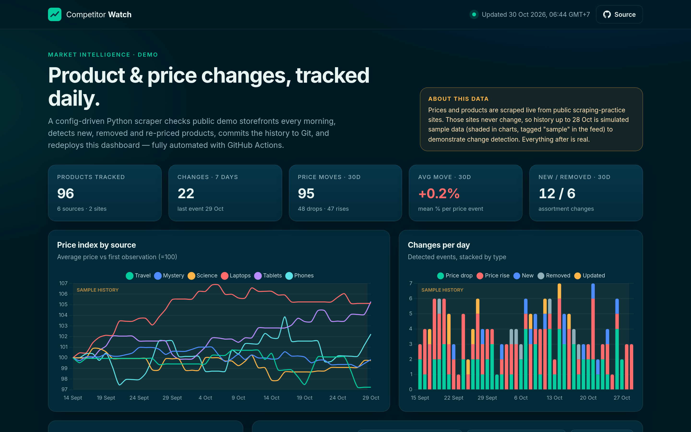
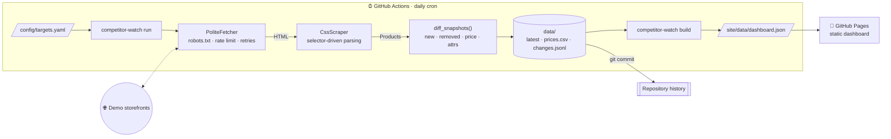
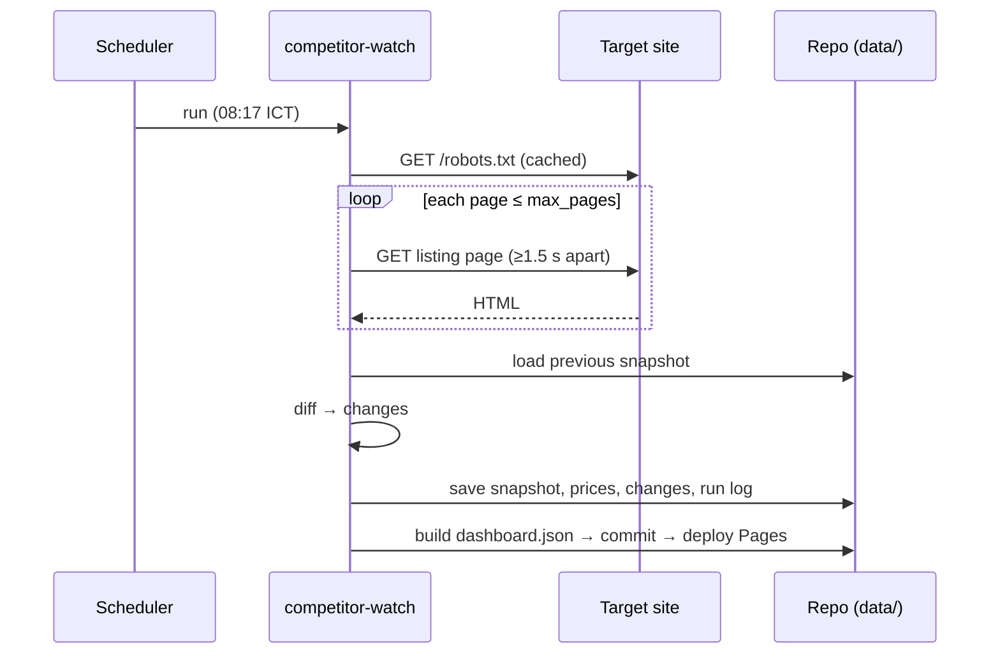
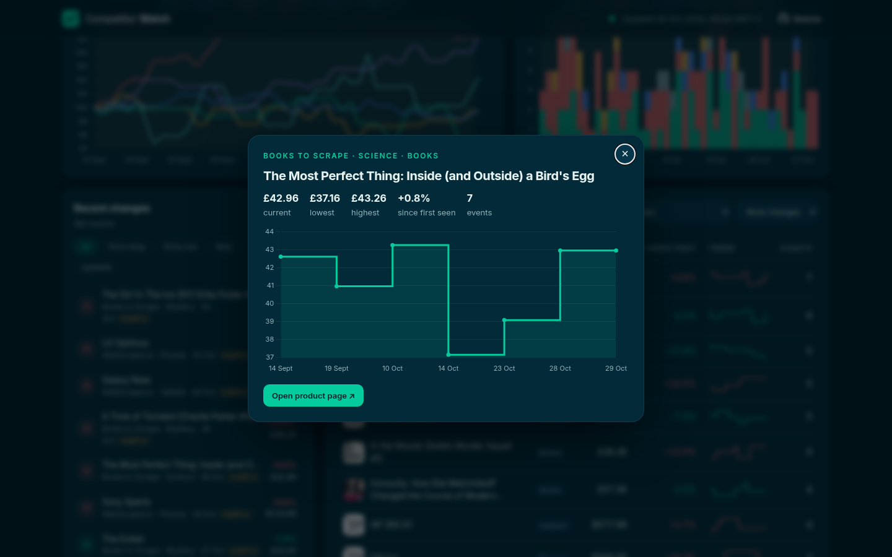
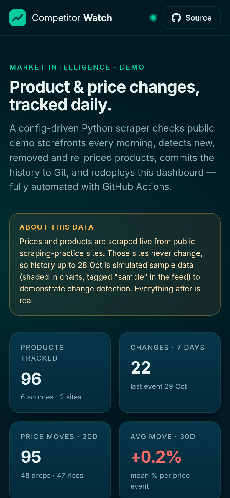
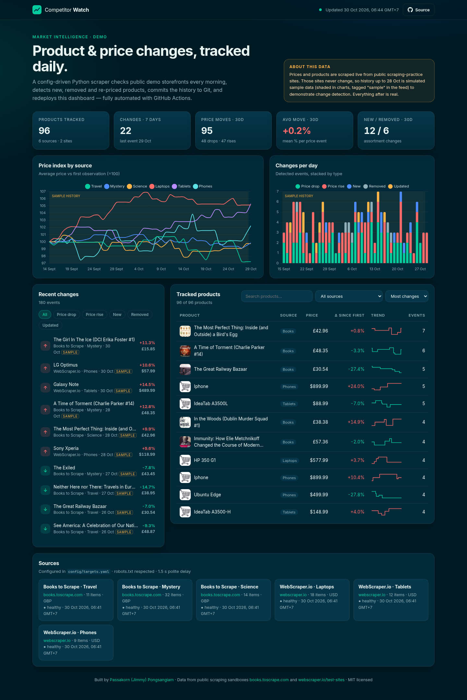

<div align="center">

# 🔭 Competitor Watch

**Config-driven product & price monitoring — Python scrapers, change detection, and a self-updating dashboard, run entirely on GitHub Actions.**

[](https://github.com/jump1852-code/competitor-watch/actions/workflows/ci.yml)
[](https://github.com/jump1852-code/competitor-watch/actions/workflows/scrape.yml)


[](LICENSE)

### [▶ Live dashboard](https://jump1852-code.github.io/competitor-watch/)



</div>

---

## Why this exists

In market-intelligence work, a lot of value hides in small, frequent changes on other websites: a price cut, a product quietly delisted, a new SKU launched. Checking by hand doesn't scale, and paid tools are often overkill.

**Competitor Watch** is a small, production-style answer to that problem. It:

1. **Scrapes** any number of storefronts described in a single YAML file (no code per site),
2. **Detects changes** between runs — *new*, *removed*, *price up / down*, and *attribute* changes such as stock status,
3. **Keeps history in Git** as plain JSON/CSV (diff-able, auditable, free),
4. **Publishes a static dashboard** to GitHub Pages — every day, automatically.

> **About the data.** This public demo only targets scraping-sandbox sites built for practice — [books.toscrape.com](https://books.toscrape.com) and [webscraper.io/test-sites](https://webscraper.io/test-sites). Their prices never change, so the repo ships with **45 days of clearly-labelled sample history** (flagged `sample: true`, shaded on charts) generated *backwards* from the real scraped prices. Every daily run after that is real.

## Features

| | |
|---|---|
| 🧩 **Config-driven** | Add a site by adding ~15 lines of YAML: item selector, field selectors, pagination, currency. |
| 🤝 **Polite by default** | Checks `robots.txt` before every request, 1.5 s per-host delay, identifiable User-Agent, capped page counts. |
| 🔁 **Resilient** | `urllib3` retries with exponential backoff on 429/5xx, honours `Retry-After`; one broken site never fails the whole run. |
| 🔍 **Change detection** | Pure, tested diff engine → `new`, `removed`, `price_up`, `price_down`, `changed` (with before/after values). |
| 🗃️ **Git as database** | `data/latest/*.json`, `data/history/prices.csv`, `data/changes.jsonl`, `data/runs.json`. |
| 📊 **Static dashboard** | Vanilla JS + Chart.js: KPIs, price index per source, daily change chart, filterable change feed, searchable product table with sparklines, per-product price history. |
| ✅ **Quality gates** | `pytest` (94 % coverage), `mypy --strict`, `ruff` lint + format, CI on Python 3.11–3.13. |

## Architecture





## Quick start

```bash
git clone https://github.com/jump1852-code/competitor-watch && cd competitor-watch
python -m venv .venv && source .venv/bin/activate
pip install -e ".[dev]"

competitor-watch run              # scrape every target, detect + store changes
competitor-watch build            # write site/data/dashboard.json
python -m http.server -d site     # open http://localhost:8000

pytest && mypy && ruff check .    # quality gates
```

Other commands: `competitor-watch run --only ws-laptops books-travel`, `competitor-watch seed --days 45 --force` (regenerate sample history).

## Adding a site

```yaml
# config/targets.yaml
- id: ws-laptops
  name: "WebScraper.io · Laptops"
  site: webscraper.io
  category: Laptops
  currency: USD
  start_url: https://webscraper.io/test-sites/e-commerce/static/computers/laptops
  max_pages: 3
  item_selector: div.thumbnail
  next_page_selector: "ul.pagination a[rel=next]"
  fields:
    name:   { selector: "a.title", attr: title }
    url:    { selector: "a.title", attr: href }
    price:  { selector: "[itemprop=price]" }
    rating: { selector: "p[data-rating]", attr: data-rating }
```

`name`, `url` and `price` are required; any of `availability`, `rating`, `reviews`, `description`, `image` are optional. `map:` translates attribute tokens (e.g. `star-rating Three` → `3`). Sites that need JavaScript rendering can plug in a Playwright-based fetcher behind the same `Fetcher` protocol.

## Change types

| Type | Trigger | Stored |
|---|---|---|
| `new` | product URL appears for the first time | new price |
| `removed` | product URL no longer listed | last known price |
| `price_up` / `price_down` | price moved by more than 0.5 ¢ | old, new, `pct_change` |
| `changed` | `name`, `availability`, `rating` or `description` differs | `fields: {name: [before, after]}` |

The first run for a target is a **baseline** — it records a snapshot but emits no events.

## Project layout

```
competitor-watch/
├── config/targets.yaml          # what to watch
├── src/competitor_watch/
│   ├── fetcher.py               # robots.txt, per-host throttle, retries
│   ├── scraper.py               # generic CSS-selector scraper (pure parse_listing)
│   ├── detect.py                # snapshot diff engine
│   ├── storage.py               # JSON / CSV persistence
│   ├── pipeline.py              # scrape → diff → persist, per target, fault-isolated
│   ├── dashboard.py             # compact JSON for the front-end
│   ├── sample.py                # labelled sample-history generator
│   └── cli.py                   # `competitor-watch run | build | seed`
├── data/                        # ← committed by the daily workflow
├── site/                        # static dashboard (HTML + CSS + JS + Chart.js)
├── tests/                       # pytest, offline HTML fixtures
└── .github/workflows/           # ci.yml · scrape.yml (cron → commit → Pages)
```

## Screenshots

| Product price history | Mobile |
|---|---|
|  |  |

<details><summary>Full-page dashboard</summary>



</details>

## Responsible scraping

- Only public, scraping-practice sandboxes are targeted in this repo.
- `robots.txt` is fetched and obeyed for every origin (`RobotsDisallowed` is raised before any request).
- Requests are spaced ≥ 1.5 s apart per host, page counts are capped, and the User-Agent links back to this repository.
- Retries back off exponentially and honour `Retry-After`.

## Roadmap

- [ ] Optional Playwright fetcher for JS-rendered sites
- [ ] Email / Teams notification when a watched SKU changes price
- [ ] Export changes to SharePoint / Power BI dataset

---

<sub>Built by **[Passakorn (Jimmy) Pongsangiam](https://jump1852-code.github.io/)** — CRM & Market Intelligence, Bangkok. MIT licensed.</sub>
